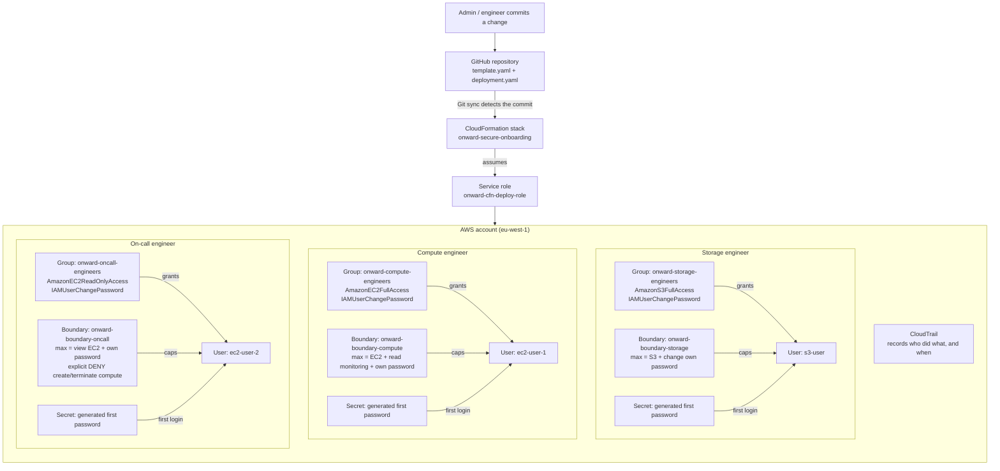

# Onward Logistics: Automated Secure Onboarding

Onward Logistics onboards 5–10 engineers a month. Access used to be clicked together by hand in the console, so the result depended on who did it. This repository defines engineer access **as code**, deployed automatically by **CloudFormation Git sync**, so access is built the same way every time, every change is traceable, and the on-call engineer can never create or terminate compute.

> **No credentials are stored in this repository.** First-login passwords are generated by AWS Secrets Manager at deploy time.

## Architecture

**How to read it:** the **group grants** permissions by job role. The **boundary caps** them: an action is allowed only if both the group and the boundary allow it, and an explicit Deny always wins. Because the boundary sits on the **user**, changing the group can never lift the cap.

## How each client requirement is met

| Requirement | How it is met |
|---|---|
| Access built the same way every time | All users, groups, policies and secrets come from one CloudFormation template. If deployment fails, CloudFormation rolls back everything, so access is never half-built. |
| A record of who changed access and when | Every change is a Git commit (author + time). Git sync shows which commit was deployed. CloudTrail records every API call. |
| On-call engineer can never create or terminate compute | A permissions boundary on `ec2-user-2` allows only viewing EC2 and explicitly denies `RunInstances`, `TerminateInstances`, `CreateFleet`, `RequestSpotInstances` and `RequestSpotFleet`. Adding permissions to the group or user cannot override it. |
| Secure first login | Secrets Manager generates a random 20-character password per engineer. `PasswordResetRequired: true` forces a change at first sign-in, so the original password stops working. |
| No inline policies | Groups use `ManagedPolicyArns` (AWS managed policies). Boundaries are standalone customer managed policies. |
| Rebuild from the repository | The whole setup is in `template.yaml`. Secret names are generated, so a rebuild never clashes with secrets pending deletion. |

## Design decisions

- **Groups by job role:** the next hire just joins a group and is ready on day one. One group is easier to audit than many individual users.
- **AWS managed policies for groups:** avoids recreating policies AWS already maintains.
- **Permissions boundaries on every user:** the "forward-looking cap" — limits what each person can ever have, regardless of future changes. A boundary was chosen over an SCP because an SCP caps the whole account, which would also block the compute engineer, and SCPs are owned at the organization level.
- **Change own password in every boundary:** without it, the boundary would block the forced password change at first sign-in. `${aws:username}` limits it to the signed-in user only.
- **IAM users instead of IAM Identity Center:** matches the lab scope (single account). Identity Center, with short-lived credentials and central offboarding, is the recommended next step as the company grows. Engineers get console access only, no access keys.

## Files

| File | Purpose |
|---|---|
| `template.yaml` | CloudFormation template: secrets, boundaries, groups, users |
| `deployment.yaml` | Git sync deployment file; points to the template and adds stack tags |

## Deploy or rebuild

One-time bootstrap (the deployment pipeline itself):

1. A **GitHub connection** (CodeConnections) so AWS can read this repository.
2. A **Git sync role**, created by the CloudFormation console.
3. A **CloudFormation service role** `onward-cfn-deploy-role`, trusted only by `cloudformation.amazonaws.com`, with `IAMFullAccess` and `SecretsManagerReadWrite` (only the two services the template uses).

Then: CloudFormation → **Create stack** → **Sync from Git** → this repository, branch `main`, deployment file `deployment.yaml`, service role `onward-cfn-deploy-role`. Every later commit to `main` is deployed automatically.

## First login (admin process)

1. Find the engineer's secret ARN in the stack **Outputs**.
2. Retrieve the password from Secrets Manager and give it to the engineer privately.
3. The engineer signs in at the account sign-in URL and is forced to set a new password.

## Evidence summary

Results from the IAM policy simulator (`aws iam simulate-principal-policy`) and real sign-ins:

| Engineer | Action | Result |
|---|---|---|
| ec2-user-2 (on-call) | `ec2:DescribeInstances` | allowed |
| ec2-user-2 (on-call) | `ec2:RunInstances` / `ec2:TerminateInstances` | explicitDeny |
| ec2-user-2 (on-call) | `s3:ListAllMyBuckets` | implicitDeny |
| **ec2-user-2 after attaching `AmazonEC2FullAccess` to both group and user** | `ec2:RunInstances` / `ec2:TerminateInstances` | **still explicitDeny** |
| s3-user (storage) | `s3:ListAllMyBuckets` / `s3:PutObject` | allowed |
| s3-user (storage) | `ec2:DescribeInstances` / `ec2:RunInstances` | implicitDeny |
| ec2-user-1 (compute) | `ec2:DescribeInstances` / `RunInstances` / `TerminateInstances` | allowed |
| ec2-user-1 (compute) | `s3:ListAllMyBuckets` | implicitDeny |

Real sign-in as `ec2-user-2`: forced password change at first login; EC2 Instances page loads; S3 shows "You don't have permissions to list buckets". The test permissions were detached afterwards. CloudTrail shows the stack creation traced to the deploying user and time; Git sync shows the deployed commit matching this repository's history.

## Limits and next steps

- IAM users still have long-lived passwords; **IAM Identity Center** would give short-lived credentials and central offboarding.
- The deployment role uses `IAMFullAccess`; a tighter custom policy would reduce it further.
- Anyone able to edit the boundary policies or the template could weaken the cap, so changes to `main` should require a reviewed pull request (branch protection), and IAM changes should be monitored in CloudTrail.
- Offboarding is a template change (remove the user and commit), which keeps it traceable but still relies on someone making that change.
